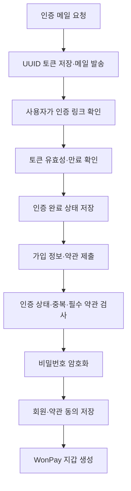
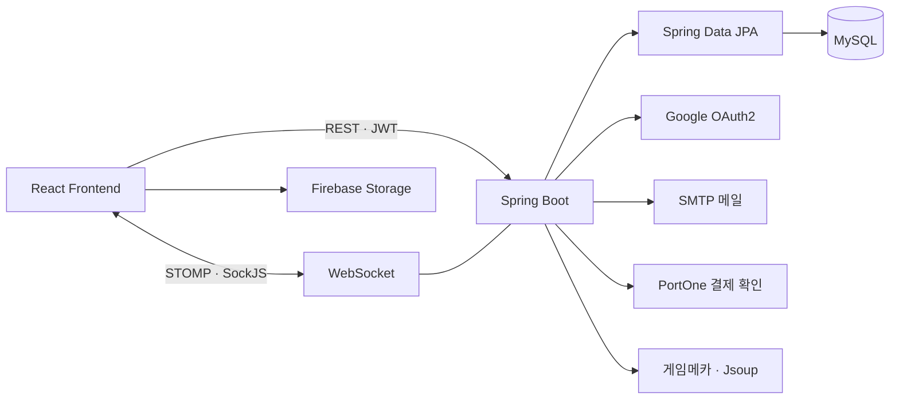

# 🎮 원딜러 WonDealer · Backend

> “원하는 걸 DEAL 하다”

게임 아이템·게임머니·계정의 일반 판매와 실시간 경매, 거래 채팅, WonPay 간이 에스크로를 제공하는 웹 서비스의 백엔드입니다.

> 이 저장소는 **5인 팀 프로젝트를 홍유나의 포트폴리오용으로 정리한 저장소**입니다.
> 개인 담당은 **회원가입·로그인, 이메일 인증, 구글 소셜 로그인, 약관 동의, 마이페이지, 계정 찾기·비밀번호 변경** 등 사용자 관련 기능입니다.

## 📌 프로젝트 개요

| 항목 | 내용 |
| --- | --- |
| 프로젝트명 | 원딜러 (WonDealer) |
| 개발 형태 | 5인 팀 프로젝트 · 백엔드 3명, 프론트엔드 2명 |
| 개발 기간 | 2026.06.02 ~ 2026.06.19 |
| 최종 발표 | 2026.06.22 |
| 백엔드 | Java 17 · Spring Boot 3.5.14 |
| 데이터 접근 | Spring Data JPA · Hibernate |
| 인증 | Spring Security · JWT · Google OAuth2 |
| 데이터베이스 | MySQL 8.0 |
| 실시간 통신 | WebSocket · STOMP · SockJS |
| 개인 담당 | 홍유나 · 백엔드 사용자 도메인 |

원딜러는 고정가 거래와 실시간 입찰을 함께 제공하고, 결제 후 아이템 전달·수령 확인을 거쳐 판매자에게 정산하는 거래 흐름을 구현한 프로젝트입니다. 회원 인증과 개인정보 관리를 거래 서비스의 공통 기반으로 연결했습니다.

## 🙋‍♀️ 홍유나 담당 업무

### 1. 회원가입 및 약관 동의

- 가입 전 이메일 인증 완료 여부 확인
- 이메일·아이디·닉네임 중복 검사
- 필수 약관 동의 및 제출한 약관 ID 검증
- BCrypt로 비밀번호를 암호화하여 회원 저장
- 회원별 약관 동의 내역 저장 및 WonPay 지갑 생성 연계

관련 코드: [AuthController](src/main/java/com/wondealer/controller/AuthController.java), [AuthService](src/main/java/com/wondealer/service/AuthService.java), [SignUpReqDto](src/main/java/com/wondealer/dto/request/SignUpReqDto.java)

### 2. 로그인 및 인증 연계

- 아이디 또는 이메일을 이용한 로그인
- 차단된 회원의 로그인 제한
- 팀의 Spring Security·JWT 기반에서 로그인 인증 및 토큰 발급 연계
- Refresh Token 저장·갱신·검증 및 로그아웃 시 삭제

JWT/Security 공통 인프라는 김현중의 담당이며, 홍유나는 회원·로그인 로직과의 연결을 담당했습니다.

관련 코드: [AuthService](src/main/java/com/wondealer/service/AuthService.java), [CustomUserDetailsService](src/main/java/com/wondealer/service/CustomUserDetailsService.java)

### 3. 이메일 인증

- 가입 전 인증 메일 발송 및 이미 가입된 이메일 검증
- UUID 인증 토큰 생성 및 저장
- 메일의 인증 링크를 통한 토큰 확인
- 인증 토큰 만료 확인과 인증 완료 상태 반영
- 메일 인증·발송 실패에 대한 오류 처리

관련 코드: [EmailService](src/main/java/com/wondealer/service/EmailService.java), [EmailVerify](src/main/java/com/wondealer/entity/EmailVerify.java), [AuthService](src/main/java/com/wondealer/service/AuthService.java)

### 4. 구글 소셜 로그인

- Google OAuth2 사용자 정보 조회
- 제공자·외부 사용자 ID를 내부 소셜 계정과 연결
- 기존 이메일 회원 연결 또는 신규 회원 생성
- 소셜 로그인 성공 후 JWT 발급·Refresh Token 저장·프론트 리디렉션 연계

관련 코드: [CustomOAuth2UserService](src/main/java/com/wondealer/service/CustomOAuth2UserService.java), [OAuth2SuccessHandler](src/main/java/com/wondealer/security/OAuth2SuccessHandler.java), [OauthAccount](src/main/java/com/wondealer/entity/OauthAccount.java)

### 5. 마이페이지 및 회원 정보 관리

- 현재 로그인 회원의 정보 조회
- 닉네임·전화번호·프로필 이미지 URL 수정
- 현재 비밀번호 검증 후 새 비밀번호 암호화 저장
- 은행명·계좌번호·예금주 등록 및 수정
- 본인의 판매 상품·구매/판매 거래·입찰 내역을 페이지 단위로 조회

관련 코드: [MemberController](src/main/java/com/wondealer/controller/MemberController.java), [MemberService](src/main/java/com/wondealer/service/MemberService.java), [MemberResDto](src/main/java/com/wondealer/dto/response/MemberResDto.java)

### 6. 계정 찾기 및 비밀번호 재설정

- 이름과 이메일에 일치하는 회원의 아이디 조회
- 반환 아이디를 일부 마스킹하여 표시
- 임시 비밀번호 생성·암호화·저장 후 이메일 안내

관련 코드: [AuthService](src/main/java/com/wondealer/service/AuthService.java), [EmailService](src/main/java/com/wondealer/service/EmailService.java)

## 🧩 회원가입 처리 흐름



가입 가능 여부를 서버에서 검증하여 이메일 인증과 필수 약관 동의를 회원 등록 흐름에 포함했습니다. 마이페이지에서는 인증된 사용자 ID를 기준으로 본인의 정보와 활동 내역을 조회합니다.

## 📡 개인 담당 API

| 기능 | 메서드 | 경로 |
| --- | --- | --- |
| 회원가입 | POST | `/auth/signup` |
| 로그인 | POST | `/auth/login` |
| 토큰 재발급 | POST | `/auth/reissue` |
| 로그아웃 | POST | `/auth/logout` |
| 아이디 찾기 | POST | `/auth/find-username` |
| 임시 비밀번호 발급 | POST | `/auth/reset-password` |
| 인증 메일 발송 | POST | `/auth/email/send` |
| 이메일 인증 확인 | POST | `/auth/email/verify` |
| Google OAuth 진입 | GET | `/oauth2/authorization/google` |
| 내 정보 조회·수정 | GET / PATCH | `/api/members/me` |
| 비밀번호 변경 | PATCH | `/api/members/me/password` |
| 계좌 등록·수정 | PATCH | `/api/members/me/bank` |
| 내 판매 상품 | GET | `/api/members/me/items` |
| 내 구매·판매 내역 | GET | `/api/members/me/trades` |
| 내 입찰 내역 | GET | `/api/members/me/bids` |

Google OAuth 진입·콜백 경로는 Spring Security가 처리합니다. API 목록은 이 복사본의 컨트롤러를 기준으로 작성했습니다.

## ✨ 프로젝트 전체 기능

| 도메인 | 구현 내용 |
| --- | --- |
| 회원·인증 | 회원가입, 이메일 인증, JWT 로그인·재발급, Google OAuth2, 계정 복구 |
| 상품 | 일반 판매·경매 등록, 게임·서버·카테고리 필터, 검색, 상세·수정·삭제 |
| 경매 | 입찰 검증, 현재가 갱신, 즉시 낙찰, 만료 경매 처리, STOMP 이벤트 전송 |
| WonPay | 잔액 조회, 충전 준비·완료 확인, 출금, 지갑 거래 기록 |
| 거래 | 결제 상태 관리, 수령 확인, 판매자 정산 및 수수료 처리 |
| 채팅 | 채팅방·메시지·읽음 처리, 실시간 메시지 및 거래 상태 알림 |
| 게임 순위 | Jsoup 기반 게임메카 크롤링 및 정기 갱신 |
| 관리자 | 회원 제재·해제, 상품 조회·삭제 |

### 실시간 경매·거래 구조

입찰 시 `AuctionRepository`의 **비관적 쓰기 락**을 사용합니다. 입찰 금액·자기 상품 입찰·잔액 등을 검증하고 이전 최고 입찰자 환불 및 현재가 변경을 처리한 뒤, STOMP로 경매 상태를 전송합니다. 기획 문서의 낙관적 락 설명보다 복사본의 실제 구현을 기준으로 정리했습니다.

거래 상태는 `PENDING_PAYMENT → PAID → COMPLETED`로 관리하며, 결제 완료 상태에서는 간이 에스크로로 보관하고 수령 확인 시 판매자 정산을 처리합니다. 이 부분은 팀의 거래 담당 구현입니다.

## 🏗️ 시스템 구성



기획 자료에는 AWS S3·토스 연동이 포함되어 있지만, 이 브랜치의 프론트 이미지 업로드 및 충전 구현은 Firebase Storage·PortOne입니다. 운영 배포 상태와 인프라 설정은 이 복사본에 포함하지 않습니다.

## 👥 팀 구성

| 이름 | 역할 | 주요 담당 |
| --- | --- | --- |
| 김현중 | 백엔드 | 프로젝트 기반, JWT/Security, WebSocket, 크롤링, 관리자 API, 배포 |
| **홍유나** | **백엔드** | **회원가입·로그인, 이메일 인증, Google OAuth, 약관, 마이페이지, 계정 복구** |
| 변후민 | 백엔드 | 상품·게임·서버·카테고리, 경매, WonPay, 거래·결제, 채팅 REST API |
| 장미선 | 프론트엔드 | 메인, 상품 목록·상세, 등록 폼, 반응형, 결제 API 연동, 관리자 화면 |
| 김형준 | 프론트엔드 | 회원·로그인 UI, 실시간 경매 UI, 채팅, 결제·WonPay UI |

## 🛠️ 기술 스택

Java 17, Spring Boot 3.5.14, Spring Security, Spring Data JPA, MySQL, JWT (jjwt), OAuth2 Client, Spring Mail, WebSocket/STOMP, Jsoup, Lombok, Springdoc OpenAPI, Gradle.

## 📂 폴더 구조

```text
src/main/java/com/wondealer/
├─ config/       # 보안·WebSocket·초기 데이터
├─ controller/   # REST API 및 메시지 컨트롤러
├─ service/      # 회원·상품·경매·거래 비즈니스 로직
├─ repository/   # Spring Data JPA
├─ entity/       # 회원·약관·거래 등 도메인
├─ dto/          # 요청·응답·실시간 메시지
├─ security/     # JWT·OAuth 인증 연계
├─ scheduler/    # 경매 종료·게임 순위 갱신
├─ crawler/      # 게임 순위 수집
└─ exception/    # 공통 예외 처리
```

## ▶️ 실행 방법

**Java 17와 MySQL 8.0**을 준비하고, MySQL에 `won_dealer` 데이터베이스를 생성합니다.

```sql
CREATE DATABASE won_dealer CHARACTER SET utf8mb4;
```

`src/main/resources/application.example.properties`를 같은 폴더의 `application.properties`로 복사합니다. `${...}`에 해당하는 환경변수를 설정하거나 로컬 설정 파일에 본인의 값을 입력합니다.

- DB 접속: `DB_USERNAME`, `DB_PASSWORD`
- JWT: `JWT_SECRET` · 32바이트 이상 난수의 Base64 문자열
- 메일: `MAIL_USERNAME`, `MAIL_PASSWORD`
- Google OAuth: `GOOGLE_CLIENT_ID`, `GOOGLE_CLIENT_SECRET`
- 초기 관리자: `ADMIN_USERNAME`, `ADMIN_EMAIL`, `ADMIN_PASSWORD`, `ADMIN_NAME`
- PortOne 충전 확인: `PORTONE_API_SECRET` · 충전 기능 사용 시 설정

Google OAuth 승인된 리디렉션 URI는 `http://localhost:8111/login/oauth2/code/google`입니다. 로그인 성공 후 프론트의 `http://localhost:3000/login-success`로 이동합니다.

```bash
# macOS / Linux
./gradlew bootRun

# Windows PowerShell
.\gradlew.bat bootRun
```

- API: `http://localhost:8111`
- Swagger UI: `http://localhost:8111/swagger-ui/index.html`
- 프론트엔드: `http://localhost:3000`
- 최초 실행 시 `DataInitializer`에서 관리자·약관·게임·서버·카테고리 데이터를 생성합니다.
- 실제 `application.properties`, `.env`, 서비스 키는 Git에 포함하지 않습니다.

```bash
./gradlew build
# Windows: .\gradlew.bat build
```

## ✅ 포트폴리오 정리 및 확인 범위

개인 역할·일정은 팀 Notion 자료를 참고했고, 기능·API·의존성은 지정된 `dev` 브랜치 코드를 확인하여 작성했습니다. 백엔드 애플리케이션 코드는 수정하지 않았으며, README·출처 문서·실행 설정 예시를 추가했습니다.

이번 정리 환경에는 Java·MySQL 및 외부 서비스 인증 설정이 없어 백엔드 빌드·통합 실행을 검증하지 않았습니다. 프론트 빌드와 인증 관련 화면은 확인했으며 [Frontend의 화면 캡처](https://github.com/h-yuna-lab/wondealer-frontend#%EF%B8%8F-주요-화면)에서 볼 수 있습니다.

프론트 통합 브랜치와 백엔드 `dev`에는 상품 수정의 `PATCH`/`PUT` 등 일부 API 차이가 남아 있으므로 전체 기능 실행 전 연동 확인이 필요합니다.

## 🔗 관련 저장소·자료

- 개인 포트폴리오 [Frontend](https://github.com/h-yuna-lab/wondealer-frontend) · [Backend](https://github.com/h-yuna-lab/wondealer-backend)
- 원본 팀 [Frontend](https://github.com/pyyzzz/wondealer-frontend/tree/feature/%EA%B9%80%ED%98%95%EC%A4%80-frontend-%ED%86%B5%ED%95%A9%EB%B3%B8) · [Backend](https://github.com/pyyzzz/wondealer-backend/tree/dev)
- [프로젝트 Notion 문서](https://app.notion.com/p/3f6cb363cc93800a8270cb210d838dca) · 접근 권한이 필요할 수 있습니다.
- [복사 기준 및 출처](docs/SOURCE.md)

팀 공동 결과물을 포트폴리오 목적으로 정리한 저장소이며, 홍유나의 개인 담당 범위는 백엔드 사용자 관련 기능입니다.


## 프로젝트 회고

회원가입·로그인부터 이메일 인증, 구글 OAuth, 계정 찾기·비밀번호 변경까지 회원 관련 기능을 담당했습니다. 이 기능들은 서로 연결되어 있어, 개별 API의 구현뿐 아니라 사용자가 가입하고 계정을 관리하는 전체 흐름을 함께 고려해야 한다는 점을 배웠습니다.

포트폴리오를 정리하면서 프론트엔드 호출과 백엔드 API 사이에 확인이 필요한 차이도 발견했습니다. 다음 프로젝트에서는 요청·응답 형식과 오류 처리 기준을 팀원들과 먼저 맞추고, 정상 동작뿐 아니라 인증 실패와 잘못된 입력까지 함께 검증하고 싶습니다.
