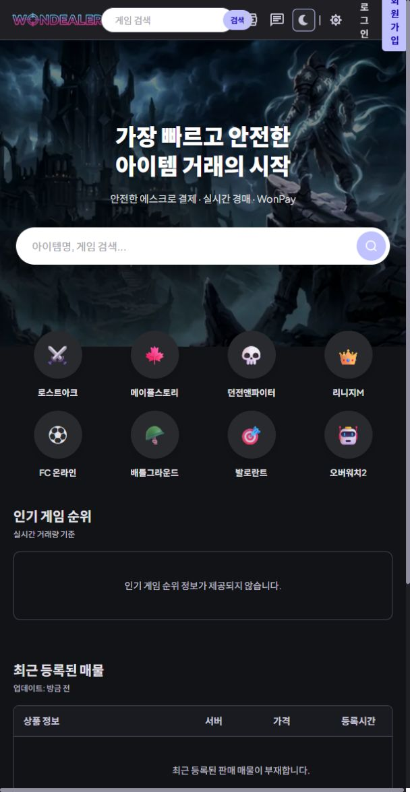
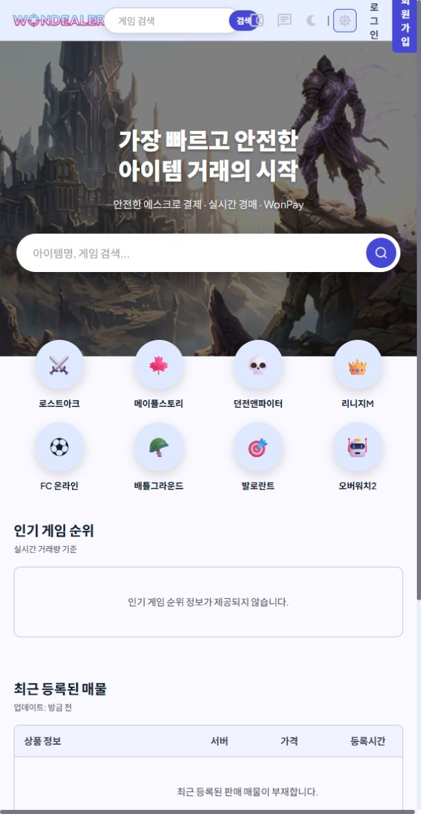
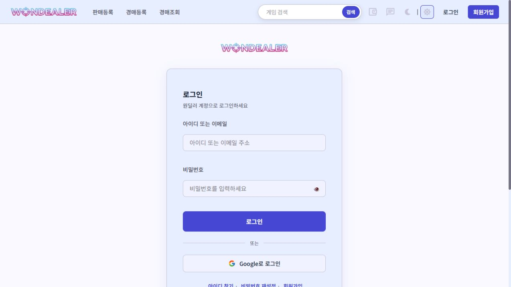
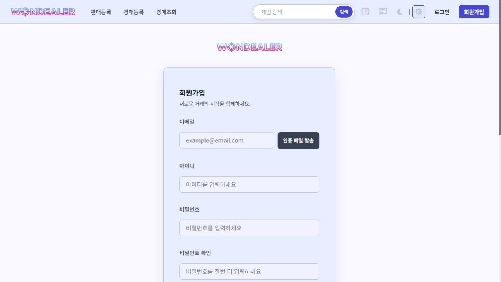
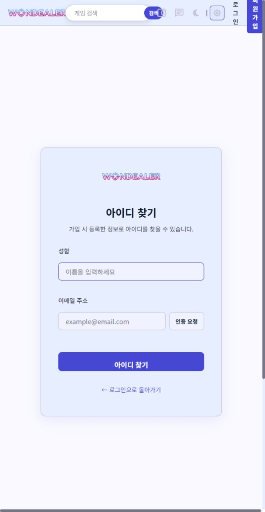
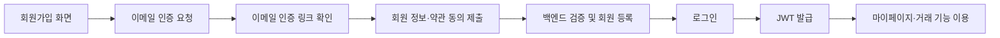

# 🎮 원딜러 WonDealer · Frontend

> “원하는 걸 DEAL 하다”

게임 아이템·게임머니·계정을 거래하고, 실시간 경매와 채팅으로 판매자와 구매자를 연결하는 웹 서비스입니다.

> 이 저장소는 **5인 팀 프로젝트를 홍유나의 포트폴리오용으로 정리한 저장소**입니다.
> 홍유나의 담당은 **백엔드 회원가입·로그인, 이메일 인증, 구글 소셜 로그인, 약관 동의, 마이페이지, 계정 찾기·비밀번호 변경**입니다. 아래 화면은 팀 프론트엔드의 구현 결과이며, 담당 백엔드와 연결되는 사용자 흐름을 함께 보여 줍니다.

## 📌 프로젝트 개요

| 항목 | 내용 |
| --- | --- |
| 프로젝트명 | 원딜러 (WonDealer) |
| 개발 형태 | 5인 팀 프로젝트 · 백엔드 3명, 프론트엔드 2명 |
| 개발 기간 | 2026.06.02 ~ 2026.06.19 |
| 최종 발표 | 2026.06.22 |
| 핵심 기능 | 일반 판매, 실시간 경매, 거래 채팅, WonPay, 회원 관리 |
| 프론트엔드 | React 18 · Create React App · React Router 6 |
| 백엔드 | Java 17 · Spring Boot · Spring Security · JPA |
| 데이터베이스 | MySQL 8.0 |
| 개인 담당 | 홍유나 · 백엔드 사용자 관련 기능 |

고정가 거래와 실시간 입찰을 함께 제공하고, WonPay 기반의 간이 에스크로와 거래 채팅으로 아이템 전달 및 수령 확인 과정을 연결하는 것을 목표로 개발했습니다. 게임메카에서 수집한 인기 게임 순위도 메인 화면에서 제공합니다.

## 🖥️ 주요 화면

아래 이미지는 이 저장소의 코드를 **로컬에서 실행하여 캡처한 실제 화면**입니다. 백엔드·데이터베이스를 연결하지 않은 상태로 촬영했으므로 메인의 매물·게임 순위는 빈 상태입니다. 인증 화면은 입력 전 상태입니다.

### 메인 · 다크 테마

게임 검색, 게임별 바로가기, 인기 게임 순위와 최근 매물 영역을 제공합니다.



<details>
<summary>메인 · 라이트 테마</summary>



</details>

### 로그인

아이디 또는 이메일 로그인과 구글 소셜 로그인 진입 화면입니다. 홍유나가 담당한 로그인·소셜 인증 백엔드와 연결됩니다.



### 회원가입

이메일 인증, 사용자 정보 입력, 약관 동의를 거쳐 가입하는 화면입니다.



<details>
<summary>아이디 찾기 · 비밀번호 재설정</summary>




</details>

## ✨ 핵심 기능

| 영역 | 구현 내용 |
| --- | --- |
| 회원·인증 | 회원가입, 이메일 인증, 로그인, 구글 OAuth, 아이디 찾기, 비밀번호 재설정 |
| 아이템 거래 | 게임·서버·카테고리 필터, 검색, 목록·상세, 판매 등록·수정 |
| 실시간 경매 | 경매 목록·상세, 입찰, 즉시 낙찰, WebSocket을 통한 현재가 갱신 |
| 거래 채팅 | 채팅방 목록, 메시지 송수신, 거래 상태 및 시스템 메시지 표시 |
| WonPay·마이페이지 | 마일리지 충전·출금 UI, 회원 정보, 판매·구매·입찰 내역 |
| 관리자 | 회원 제재, 상품 관리 화면 |
| 테마 | 다크·라이트 테마, 반응형 스타일 |

## 🙋‍♀️ 홍유나 담당 업무

**개인 구현의 중심은 백엔드 사용자 도메인입니다.** 화면 구현 역할은 아래 팀 역할표에 표시했습니다.

- **회원가입·약관 동의:** 이메일 인증 여부, 이메일·아이디·닉네임 중복, 필수 약관 동의를 검증하고 회원을 등록합니다.
- **로그인:** 아이디 또는 이메일로 로그인하고, 팀의 JWT/Security 기반 인증 구조와 연결합니다.
- **이메일 인증:** 인증 메일 발송, UUID 토큰 확인 및 만료 처리를 구현합니다.
- **구글 소셜 인증:** 외부 사용자 정보와 내부 회원·소셜 계정을 연결합니다.
- **마이페이지:** 내 정보 조회·수정, 프로필 이미지 URL 반영, 비밀번호·계좌 정보 변경, 판매·거래·입찰 내역 조회를 제공합니다.
- **계정 복구:** 이름·이메일 기반 아이디 찾기와 마스킹, 임시 비밀번호 발급·메일 발송을 처리합니다.

구현 파일과 API 상세는 [Backend 저장소](../backend/README.md)의 README에서 확인할 수 있습니다.

## 👥 팀 구성

| 이름 | 역할 | 주요 담당 |
| --- | --- | --- |
| 김현중 | 백엔드 | 프로젝트 기반, JWT/Security, WebSocket, 크롤링, 관리자 API, 배포 |
| **홍유나** | **백엔드** | **회원가입·로그인, 이메일 인증, 구글 OAuth, 약관, 마이페이지, 계정 복구** |
| 변후민 | 백엔드 | 상품·게임·서버·카테고리, 경매, WonPay, 거래·결제, 채팅 REST API |
| 장미선 | 프론트엔드 | 메인, 상품 목록·상세, 등록 폼, 반응형, 결제 API 연동, 관리자 화면 |
| 김형준 | 프론트엔드 | 회원·로그인 UI, 실시간 경매 UI, 채팅, 결제·WonPay UI |

## 🛠️ 기술 스택

- **화면:** React 18, JavaScript, React Router 6, styled-components, CSS
- **통신:** Axios, STOMP, SockJS
- **이미지 업로드:** Firebase Storage
- **WonPay 충전 연동:** PortOne 브라우저 SDK
- **화면 구성:** lucide-react, Recharts 의존성 포함
- **협업:** Git, GitHub, Notion

기획 문서의 S3·토스 구성과 달리, 이 복사본에서 확인한 이미지 업로드 및 충전 코드는 Firebase Storage와 PortOne을 사용합니다.

## 🧩 사용자 기능 연결 흐름



Axios 인터셉터에서 Access Token을 요청에 첨부하고, 인증 오류 응답에 대해 토큰 재발급을 요청합니다. 경매·채팅은 STOMP over SockJS로 실시간 이벤트를 수신합니다.

## 📂 폴더 구조

```text
src/
├─ api/          # 인증·상품·경매·거래 API
├─ components/   # Navbar, Footer, 인증 라우트
├─ context/      # 로그인 상태, 테마
├─ hooks/        # WebSocket 연결
├─ pages/        # 메인·회원·상품·경매·채팅·마이페이지·관리자
├─ styles/       # 전역 스타일 및 테마
└─ utils/        # 공통 설정, 이미지 업로드 등
```

## ▶️ 실행 방법

Node.js와 Yarn Classic 또는 npm을 준비합니다. 원본의 `yarn.lock`을 사용하려면 다음과 같이 실행합니다.

```bash
yarn install --frozen-lockfile
yarn start
```

npm을 사용하는 경우 `npm install` 후 `npm start`를 실행합니다.

- 프론트엔드: `http://localhost:3000`
- 백엔드: `http://localhost:8111`
- 이미지 업로드·WonPay 충전을 사용할 때 `.env.example`을 `.env`로 복사하고 본인 서비스의 설정값을 입력합니다.
- API 주소는 `src/utils/Common.js`, WebSocket 주소는 `src/hooks/useWebSocket.js`, 구글 로그인 주소는 `src/pages/auth/LoginPage.js`에 지정되어 있습니다. `.env`의 `REACT_APP_API_URL`만 변경하는 방식은 원본 코드에 적용되어 있지 않습니다.
- 전체 기능을 이용하려면 백엔드·MySQL·메일·OAuth·외부 서비스 설정이 필요합니다.

```bash
yarn build
```

## ✅ 확인 범위

포트폴리오 정리 시 프론트 프로덕션 빌드가 성공했고, 메인·테마 전환·로그인·회원가입·아이디 찾기·비밀번호 재설정 화면을 로컬 브라우저에서 확인했습니다. 백엔드 연결 및 실제 결제·메일 발송은 이번 확인에 포함하지 않았습니다.

원본 브랜치의 일부 API 호출과 백엔드 `dev`의 제공 API에는 차이가 있습니다. 상품 수정의 `PATCH`/`PUT`, 찜·일부 경매 보조 API 등은 전체 연동 실행 전에 확인이 필요합니다. 애플리케이션 코드는 팀 결과물 그대로 보관했습니다.

## 🔗 관련 저장소·자료

- 개인 포트폴리오 [Frontend](../frontend/README.md) · [Backend](../backend/README.md)
- 원본 팀 [Frontend](https://github.com/pyyzzz/wondealer-frontend/tree/feature/%EA%B9%80%ED%98%95%EC%A4%80-frontend-%ED%86%B5%ED%95%A9%EB%B3%B8) · [Backend](https://github.com/pyyzzz/wondealer-backend/tree/dev)
- [프로젝트 Notion 문서](https://app.notion.com/p/3f6cb363cc93800a8270cb210d838dca) · 접근 권한이 필요할 수 있습니다.
- [복사 기준 및 출처](docs/SOURCE.md) · [원본 README](docs/README.original.md)

이 저장소는 팀 공동 결과물의 포트폴리오용 복사본입니다. 개인 담당 범위는 홍유나의 백엔드 사용자 관련 기능입니다.


## 프로젝트 회고

회원·인증 백엔드 개발 경험과 개선 방향은 [홍유나의 원딜러 프로젝트 회고](../backend/README.md)에 정리했습니다.
